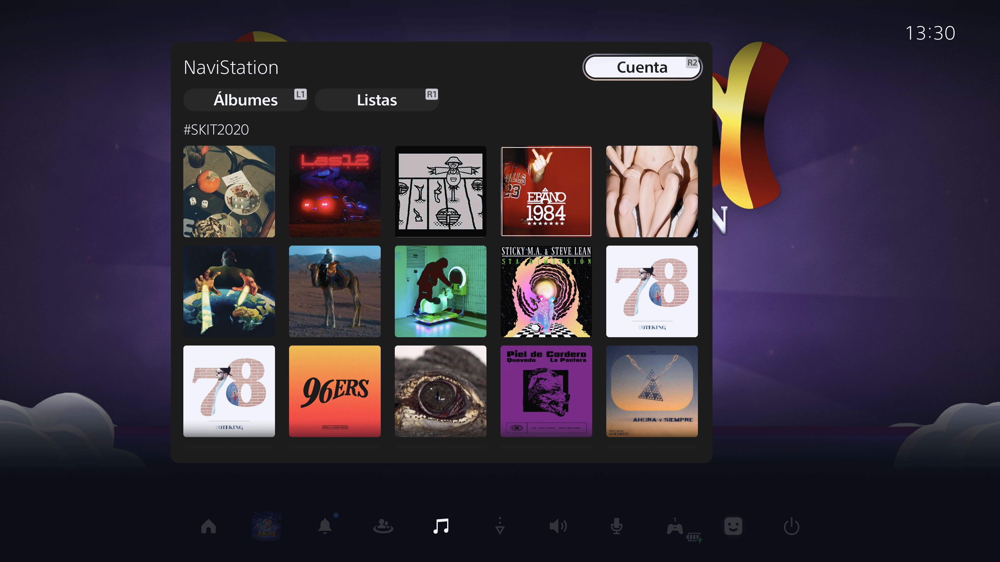
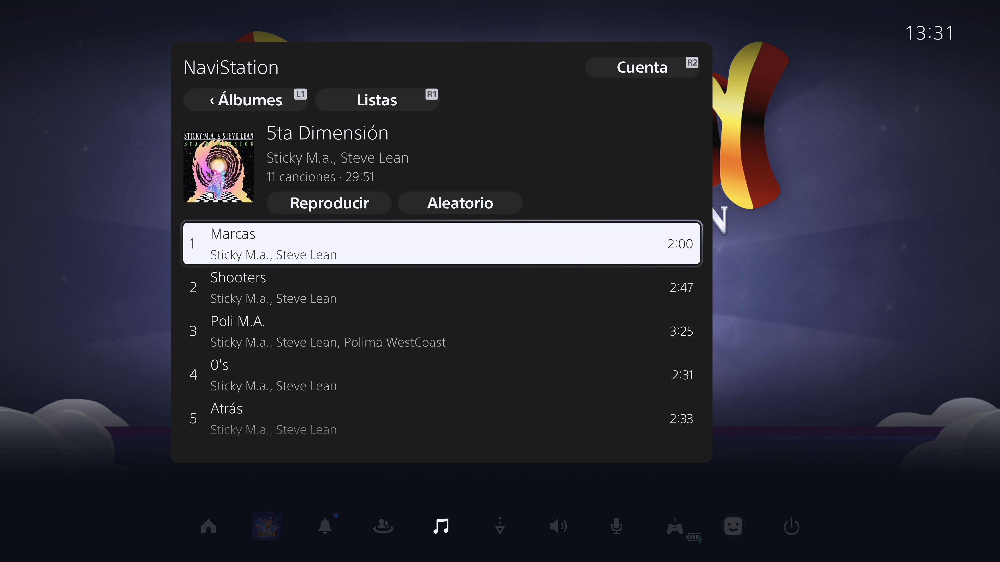
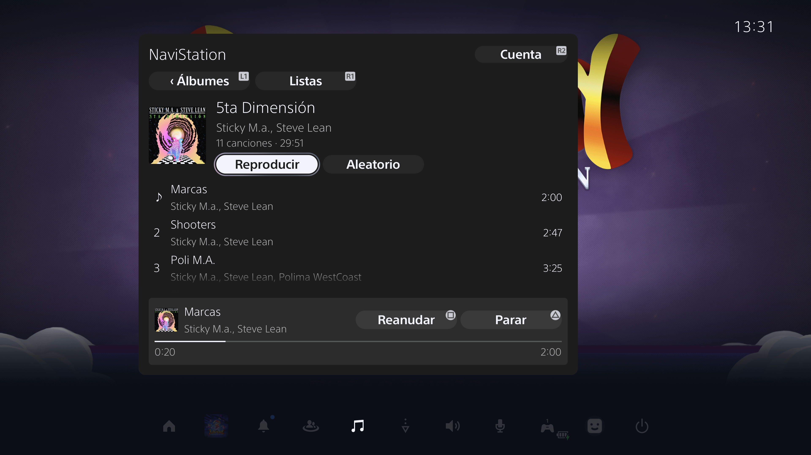

# NaviStation5

Play a Navidrome library from the PS5 Control Center Music card, including while
playing a game. NaviStation5 runs in Control Center and needs no foreground app
or separate audio server.

Supports **PS5 firmware 13.20**. Other firmware is rejected.

- Browse albums and playlists by cover, with continuous album scrolling.
- Play collections in order or shuffle them; the queue continues with Music closed.
- Control playback and view progress from the card.
- Receive a silent notification when each song starts.
- Keep your Navidrome login across console restarts.
- Use Spanish, English, French, German, Italian or Portuguese automatically,
  following the console language. Unsupported languages fall back to English.

L1 opens Albums and R1 opens Playlists. Square pauses or resumes when the player
is visible; Triangle stops playback and R2 opens Account. Albums with one song
play directly.
Selecting an individual song plays that song; **Play** and **Shuffle** start the
whole collection. Navidrome supplies the song, artist and album names.

## Screenshots

**Album library** — browse cover artwork from the PS5 Music card.



**Album details** — tracks, durations, Play and Shuffle.



**Playback** — progress and native controller shortcuts.



Captured directly from a PS5 running firmware 13.20, with the Music card open
over Home.

## Download

Download `navistation5.elf` from [Releases](https://github.com/ivanmzcom/navistation5/releases).
The release build uses `http://navidrome.local:4533` as an editable default;
enter your server URL and credentials in the Music card. See [Load](#load).
Only firmware 13.20 is supported.

## Build

Requires Node.js 20+, Python 3, Make,
[ps5-payload-sdk](https://github.com/ps5-payload-dev/sdk), LLVM 18 and
[Hermes 0.12.0](https://github.com/facebook/hermes/releases/tag/v0.12.0)
with HBC version 89.

```sh
npm ci
cp config.example.json config.local.json
# Set serverUrl in config.local.json.
export PS5_PAYLOAD_SDK=/path/to/ps5-payload-sdk
export LLVM_CONFIG=/path/to/llvm-18/bin/llvm-config
export HERMESC=/path/to/hermesc
npm test
npm run build
```

Output: `build/navistation5.elf`. The build embeds the server origin and generates
a local control token. `serverUrl` accepts HTTP(S) origins without credentials,
paths or query strings. Local configuration and generated files are ignored by Git.

Enter your Navidrome username and password on the console. A successful login
saves a reusable access token on the PS5; **Sign out** removes it. The password
is not saved. The token has no refresh cycle: it remains usable while the server
accepts it. The saved token is not encrypted.

The native bootstrap must match its reviewed fingerprint. A different compiler
or bootstrap changes require a new review; see [Contributing](CONTRIBUTING.md).

## Load

1. Activate the jailbreak and ELF loader.
2. Send `navistation5.elf` through the loader, usually on TCP port 9021.
3. Open Control Center → Music and sign in. If Music was already open when you
   loaded the ELF, close and reopen it.

The installer needs the Control Center runtime to be available. If installation
fails because that runtime is not initialized, open Control Center and load the
ELF again. Opening Music before loading is not a requirement.

Load once per boot. The ELF discovers the current ShellUI session and can be
reused after a restart. A repeat load preserves a working card; it does not
replace that card with a newer build. Restart the console before loading an
updated build. No companion audio app is needed.

## Validation

Hardware checks on the development console covered playback in Home and Rayman,
card controls, login restoration after reboot, automatic ShellUI discovery,
controller navigation, shuffle and advancement to the next album song with Music
closed. The console language was detected as `es-ES`; automated tests cover all
six UI languages and regional variants.

The development console's HDMI capture setup has also produced silent audio
after reboot without NaviStation5 running. The shutdown drain does not resolve
that capture issue.

`npm test` covers playback ownership, queues, notifications, credentials,
controller navigation, translations and installer guards. See
[Architecture](docs/ARCHITECTURE.md) for runtime behavior.

## License

GPL-3.0-or-later; see [LICENSE](LICENSE) and [Notices](NOTICE.md).
Sony binaries, console dumps and music are not included. This project is not
affiliated with Sony or Navidrome.
